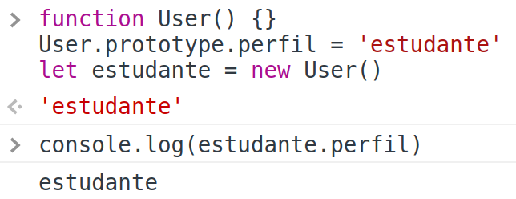
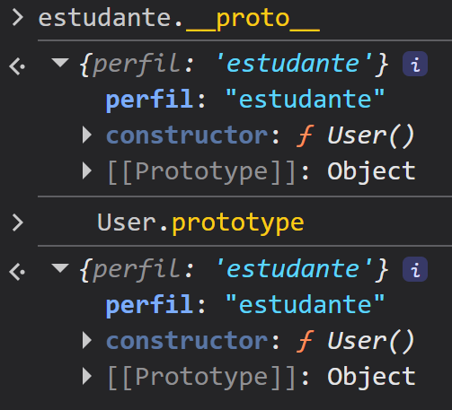
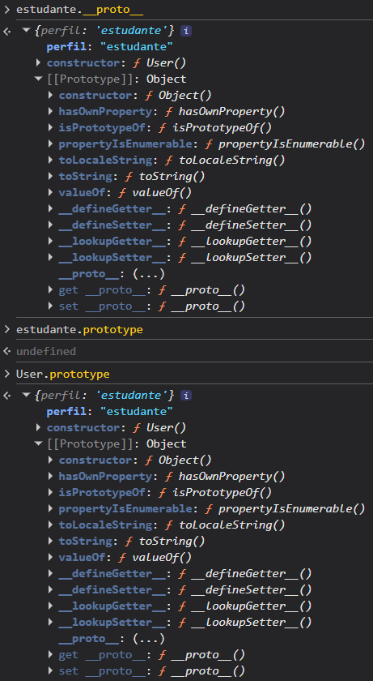

# Programação Orientada a Objeto (POO | OOP)

A programação a objeto é uma forma de organizar seu código de acordo com conceito de objetos. Ou seja, o nosso código é estruturado em torno de classes e objetos que representam entidades do mundo real.

## Objetos

Os objetos são unidades que reúnem dados (atributos) e comportamentos (métodos).

Vamos imaginar um usuário de um site qualquer, ele tem um nome, um e-mail e geralmente uma senha. Ele também pode conseguir ver suas informações, certo?

O usuário é um objeto, seu nome, e-mail e senha são seus __atributos__ e seu __comportamento__ é ver suas informações. Vamos estruturar isso dentro do código.

```js
const user = {
  name = 'Ari'
  email = 'a@a.com'
  password = '123abc'

  ver_info = function() {
    console.log(`Your name is ${this.name} and your e-mail is ${this.email}`)
  }
}
```

## `this`

Usamos o `this` sempre que quisermos nos referir a uma propriedade do contexto que estamos inseridos. No exemplo acima o nosso contexto era o usuário, por isso conseguimos executar com sucesso a função `ver_info`.

```js
user.ver_info() 
// Your name is Ari and your e-mail is $a@a.com
```

## Protótipos

Protótipos são objetos base que possuem propriedades e métodos reutilizáveis. A herança de protótipo permite que um objeto herde funcionalidades de outro objeto, compartilhando comportamento sem duplicar código.

```js
const user = {
  name: 'Ari',
  age: 23,
  email: 'a@a.com',
  role: 'user',
  active: true,
  showInfo: function() {
    console.log(`Hi ${this.name}! your email is: ${this.email}. Your account is ${this.active ? 'active' : 'not active'}`)
  }
}

const admin = {
  name: 'Naná',
  age: 21,
  email: 'n@n.com',
  role: 'admin',
  createCourse: function() {
    console.log('Course created! =)')
  }
}

// variável admin herda propriedades da variável user
Object.setPrototypeOf(admin, user);
```

Nesse exemplo `admin` herda a propriedade `active = true` e o métodos `showInfo` do objeto `user`.

### \_\_proto\_\_ Vs prototype

Em resumo:

`__proto__` é uma propriedade que todos os objetos têm e que aponta para o protótipo que foi definido para aquele objeto.

`prototype` é uma propriedade da função que é definida como protótipo quando usamos new para criar novos objetos.

Exemplo:



Se tentarmos acessar as propriedades `prototype` e `__proto__` de estudante, obtemos os seguintes retornos:



Você também pode ter notado que alguns objetos também possuem uma propriedade chamada `[[Prototype]]`. Vamos abordar sobre isso na próxima sessão.

### Protótipo vs `prototype`

Praticamente todos os dados criados em JavaScript (objetos, arrays etc.) têm um protótipo (`[[Prototype]]`), porém apenas alguns deles têm a propriedade `prototype`. 

Todos os objetos criados a partir de `Object`, `Array`, `String` etc. têm um protótipo que foi “herdado” destes, mas não necessariamente têm uma propriedade `prototype`.

Na imagem abaixo podemos ver que estudante não tem a propriedade `prototype` porque ele não é a função que foi chamada com o `new`. Nesse caso que tem a propriedade `prototype` é o User, pois ele é a função que foi definida como protótipo nos nossos testes anteriores. Mas ambos tem um `[[Prototype]]` pois eles são criados a partir de um objeto.



### Cópia vs referência

Os métodos e propriedades não são copiados de um objeto para outro na cadeia de protótipos. Eles são acessados pelo interpretador ao percorrer a cadeia (herança) e os métodos executados de acordo com o this, ou seja, o contexto em que o método foi executado.

#### Considerações finais

- O uso do `__proto__` é apenas para exemplificar e acessar cadeias de protótipos. Ela foi descontinuada e pode ser removida dos padrões web e navegadores. ([Consulte a documentação](#deprecated))

- Não é recomendável alterar diretamente o prototype, pois alterar diretamente as regras de herança de qualquer objeto afeta a performance do código em qualquer interpretador, tanto no Node.js quanto em navegadores.

- Todas as propriedades de uma cadeia de protótipos são enumeradas, e o tempo que o interpretador leva para pesquisar uma propriedade, desde o nível mais alto na cadeia, pode ser longo e impactar o desempenho. Além disso, se o código tentar acessar uma propriedade não existente, vai percorrer toda a cadeia durante a busca. Assim, não é uma boa prática criar longas cadeias de protótipos.

### Constructor

A forma que aprendemos anteriormente de herança de protótipo não é a forma usual de criar objetos em JS quando não temos classe. Normalmente utilizamos usando funções construtoras (`constructor`) e o operador `new`.

Para construimos um constructor definimos uma função que pode ou não ter parâmetros. Agora precisamos definir como construir nosso objeto, ou seja, tudo o que for propriedade dele, utilizando o `this`. Vamos usar como exemplo o objeto [User](./aula-prototype/src/Utils/User.js):

``` js
function User(name, email, phone, address, role) {
  this.name = name
  this.email = email
  this.phone = phone
  this.address = address
  this.role = role

  this.showInfo = function() {
    console.log(`Your name is :${this.name}, your e-mail is ${this.email}`)
  }
}
```

### Operador `new`

O `new` serve para criamos uma nova instância do nosso objeto, ou seja, sempre que precisarmos criar um novo objeto de um construtor ou classe.

``` js
const admin = new User('Ari', 'a@a.com', 12123456789, 'rua 123', 'Admin')
```

### `Object.create`

Assim como o `new` o `Object.create` serve para criar uma instância a partir de um construtor. Mas diferete do `new`, precisamos primeiro criar um objeto (`Object.create()`) e depois atribuir um valor (`variavel.init()`). Veja o exemplo a partir do exercício [object-create](./aula-prototype/object-create.js):

``` js
const user = {
 init: function(nome, email) {
   this.nome = nome
   this.email = email
 },
 exibirInfos: function() {
   return `${this.nome}, ${this.email}`
 }
}

const ari = Object.create(user)
ari.init('Ari', 'a@a.com')

console.log(ari.exibirInfos())
```

### Factory Function

Ela é nada mais nada mesmo do que uma função que retorna um objeto. Vamos usar como exemplo a função [createUser](./aula-prototype/factory-function.js):

``` js
function createUser(name, email, phone, address, role) {
  let user = new User(name, email, phone, address, role)

  Admin.prototype = Object.create(user)
  Student.prototype = Object.create(user)

  user = role === 'Admin' ? new Admin() : new Student()

  return user
}
```

## Classes

As classes são baseadas no protótipo e elas não existiam nas primeiras versões do JavaScript. Para criarmos uma classe utilizamos a palavra-chave `class` seguida do seu nome (sempre importante colocar a primeira letra do nome em maiúsculo).

Dentro da nossa classe precisamos passar o nosso construtor utilizando `constructor(){}`, assim como nas nossas funções contrutoras precisamos declarar as nossas propriedades, caso elas existam, utilizando o `this` passando nosso parâmetro declarado entre parênteses. Vamos usar como exemplo a classe [User](./aula-class/src/Utils/User.js):

```js
class User {
  constructor(name, email, birth, role, active=true) {
    this.name = name
    this.email = email
    this.birth = birth
    this.role = role || 'Student'
    this.active = active
  }

  showInfo() {
    return `Your name is: ${this.name}, your e-mail is ${this.email}`
  }
}
```

### Adicionando Métodos

Um outro exemplo que podemos ver acima, é como declarar um método (comportamento) dentro da nossa classe. É bem simples, só colocar o nome da função seguida de `() {}`.

### Instânciando uma Classe

Como mencionado mais acima, para instânciarmos uma classe basta utilizar o `new` seguido do nome da classe e os seus parâmetros, se existir.

```js
const admin = new User('Ari', 'a@a.com', '2003-01-25', 'Admin')
```

### Exportando e Importando Classes

Para exportar classes existem duas formas, através do CommonJS ou ESModules. Não vou abordar a fundo nesse documento, mas você pode entender mais [nesse documento](https://github.com/whyariel2/node-dio#m%C3%B3dulos).

Para o nosso exemplo vou utilizar o ESModules, vamos usar como exemplo a classe [User](./aula-class/src/Utils/User.js) novamente.

__Exportar:__
```js
export default class User {
  ...
}
```

__Importar:__
```js
import User from './src/Utils/User.js'
```

### Herânça de Classe

Para herdar propriedades de outra classe existente, precisamos importar a classe que desejamos herdar. 

Depois utilizamos a palavra-chave `extends` seguido do nome da classe importada após o nome da classe que estamos criando. Nesse caso vamos utilizar o exemplo da classe [Admin](./aula-class/src/Utils/Admin.js).

```js
import User from './src/Utils/User.js'

class Admin extends User{
  ...
}
```

No caso da classe `User`, temos as propriedades `name`, `email`, `birth`, `role`, `active` que queremos herdar para nossa classe `Admin`. Para isso, chamamos elas como parâmetro no `constructor` e utilizamos a função `super()` junto com os parâmetro queremos herdar de `User`.

```js
class Admin extends User{
  constructor(name, email, birth, role = 'Admin', active = true) {
    super(name, email, birth, role, active)
  }
  ...
}
```

Utilizamos `role = 'Admin'` porque nesse caso nosso role por padrão vai ser sempre "Admin".

Quando trabalhamos com orientação a objetos, muitas vezes utilizamos dois tipos de nomenclatura. Podemos falar tanto de classes __parent__ e __children__ (ou seja, classes pais e filhas), quanto de __superclasse__ e __subclasse__.

#### Observações
- O `constructor` e os métodos não são obrigatorios para termos uma classe, ou seja, podemos ter uma classe que tem um construtor mas não tem métodos ou vice-versa.
- As classes não são _hoisted_, ou seja, não conseguimos instanciar uma classe antes de declará-la.
- Toda classe em JavaScript segue implicitamente o que chamamos de modo estrito (_strict mode_). É como se tivesse no topo do arquivo um string escrito "_strict mode_". Isso serve para impedir que alguns comportamentos da linguagem causem “falhas silenciosas” (ou seja, falhas que não resultam em lançamento de erros pelo programa) e corrigir alguns outros que podem induzir bugs potenciais e comportamentos inesperados. [Leia mais aqui](#stricti-mode)

## Encapsulamento

O encapsulamento é o ato de definirmos atributos e/ou métodos como privados, ou seja, para ocultarmos e não conseguirmos acessar e/ou modificar fora da nossa instância.

No JavaScript, geralmente implementamos encapsulamento usando duas ferramentas. Uma delas é através de __atributos privados__ e a outra através de __métodos acessores__.

### Atributos Privados

Indicamos que um atributo ou propriedade de uma classe é privada utilizando `#` qunado utilizamos o `this`. Precisamos também declarar o atributo fora do nosso `constructor`. Veja o exemplo abaixo com base no [User](./aula-encapsulation/src/Utils/User.js):

```js
class User {
  #name
  #email
  #birth
  #role
  #active
  constructor(name, email, birth, role, active=true) {
    this.#name = name
    this.#email = email
    this.#birth = birth
    this.#role = role || 'Student'
    this.#active = active
  }

  showInfo() {
    return `Your name is: ${this.#name}, your e-mail is ${this.#email}`
  }
}
```

### Métodos Privados

Assim como o atributo, utilizamos `#` na frente do nosso método para definí-lo como privado. Vamos ver o exemplo da classe [Draw](./aula-encapsulation/src/Utils/Draw.js):

```js
class Draw {
  ...
  // private method
  #findDrawNumber(draw_number, students) {
    const find_number = students.find(student => student.draw_number == draw_number)

    if( find_number == undefined) {
      return false;
    } else {
      return true
    }

  }
  ...
}
```

#### Pontos Importantes
- Caso tentarmos fazer um `console.log()` no atributo `name` de uma instância de `User`, o valor `undefined` é retornado pois não existe a propriedade name, e sim #name.
- Caso tentarmos fazer um `console.log()` no atributo `#name` de uma instância de `User`, um erro é retornado pois `#name` é privado.
- Mesma coisa para caso terntarmos atribuir um valor a propriedade.
- O Node começou a implementar a sintaxe de `#` para campos privados na versão 12 e concluiu na versão 16. Portanto, se você estiver usando uma versão muito antiga, essa funcionalidade pode não estar disponível.

Observamos que campos privados são eficazes em impedir que outras partes do código acessem propriedades e métodos que não deveriam. No entanto, eles são tão restritivos que nem mesmo subclasses, que teoricamente poderiam acessar esses campos privados, conseguem fazê-lo. Para resolver esse problema utilizamos algo chamamos de __métodos acessores__ (_getters_ e _setters_).


### _Getters_

Usamos a palavra-chave `get` antes de um método com o nome da nossa propriedade para que possamos apenas ler uma propriedade fora da nossa classe. Dentro do método retornamos a propriedade privada usando o `this`. Vamos ver o exemplo adionado em `User`:

```js
class User {
  ...
  get name(){
    return this.#name
  }
  ...
}
```

Os _getters_ são acessados como se fossem propriedades, não como função.

```js
const user = new User('Ari', 'a@a.com','2003-01-25')

console.log(user.name)
// Ari
```

### _Setters_

Usamos a palavra-chave `set` antes de um método com o nome da nossa propriedade para que fora da nossa classe possamos atribuir um novo valor a propriedade. O _setter_ aceita somente um parâmetro, o novo valor a ser atribuido. Vamos ver o exemplo adionado em [Student](./aula-encapsulation/src/Utils/Student.js):

```js
class Student {
  ...
  set draw_number(new_draw_number) {
    ...
    this.#draw_number = new_draw_number
  }
}
```

Beleza, mas se eu defini uma propriedade como privada, pra que eu vou querer modificar ela? 

No setter podemos implemetar lógica interna. Ou seja, podemos validar se o dado é válido, se a pessoa que está fazendo aquela alteração tem permissão para isso, autenticação, etc. Veja o exemplo:

```js
class Student {
  ...
  set draw_number(new_draw_number) {
      if (new_draw_number === String(new_draw_number) || new_draw_number == undefined){
        throw new Error('Number format is not valid')
      }

      this.#draw_number = new_draw_number
  }
}
```

O `setter` são definidos como propriedade usando o operador de `=`

```js
const student = new Student('Ari', 'a@a.com','2003-01-25')

student.draw_number = 32
```

## Documentações

- [POO: o que é programação orientada a objetos? | Alura Cursos Online](https://www.alura.com.br/artigos/poo-programacao-orientada-a-objetos)
- [Object - JavaScript | MDN](https://developer.mozilla.org/pt-BR/docs/Web/JavaScript/Reference/Global_Objects/Object)
- <a id='deprecated' >[Object.prototype.\_\_proto\_\_ - JavaScript | MDN](https://developer.mozilla.org/pt-BR/docs/Web/JavaScript/Reference/Global_Objects/Object/proto)</a>
- <a id='stricti-mode' >[Strict mode - JavaScript | MDN](https://developer.mozilla.org/pt-BR/docs/Web/JavaScript/Reference/Strict_mode)</a>

## Material de Estudo

- [JavaScript: programação Orientada a Objetos | Alura](https://cursos.alura.com.br/course/javascript-programacao-orientada-objetos)
- [Prática Protótipos](./aula-prototype/)
- [Prática Classes](./aula-class/)
- [Prática Encapsulamento](./aula-encapsulation/)